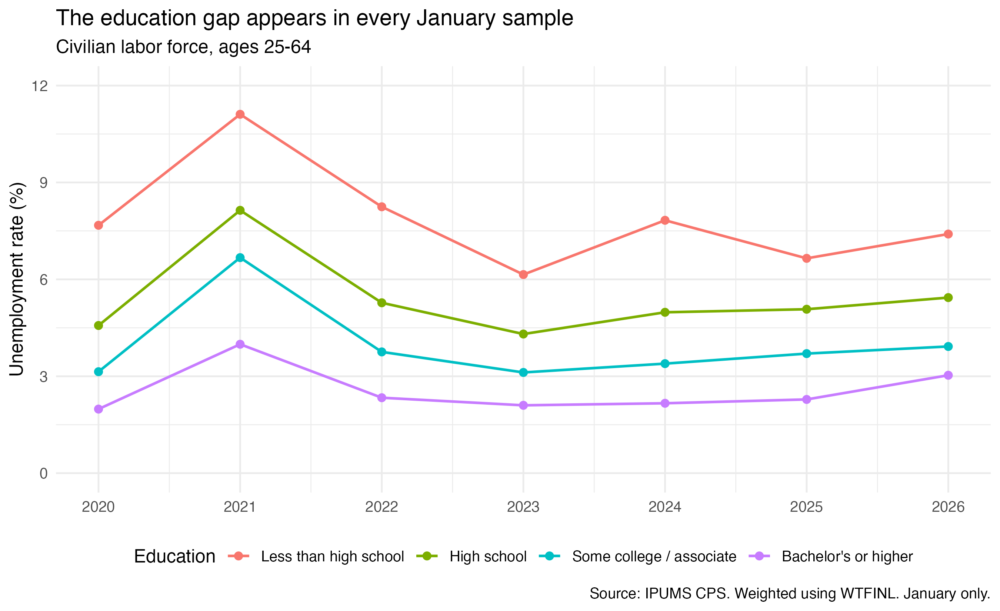
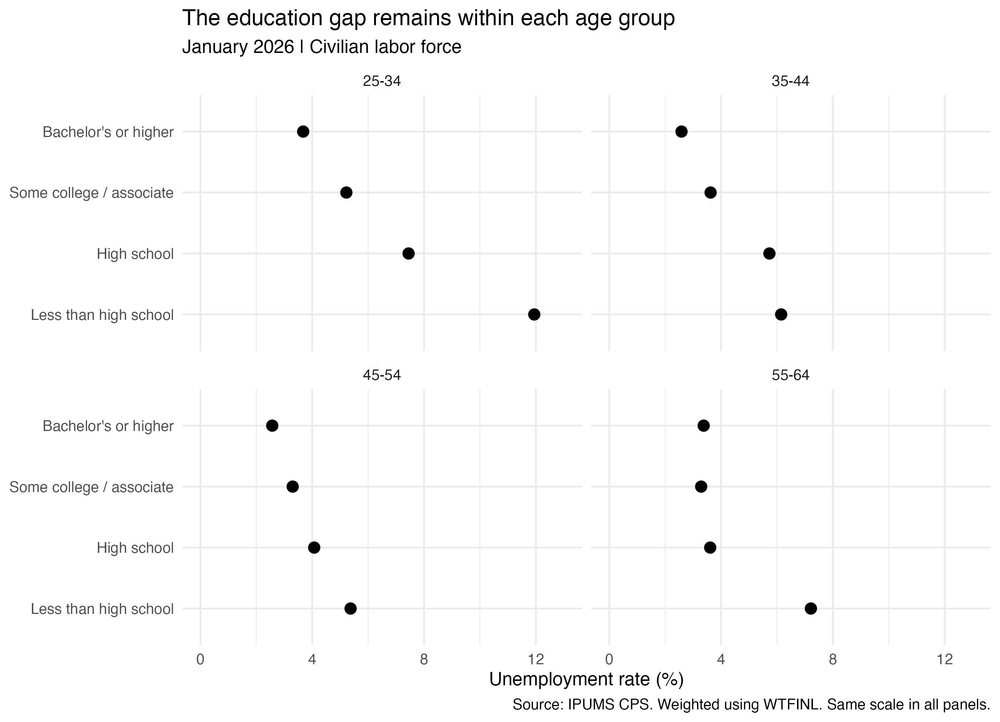
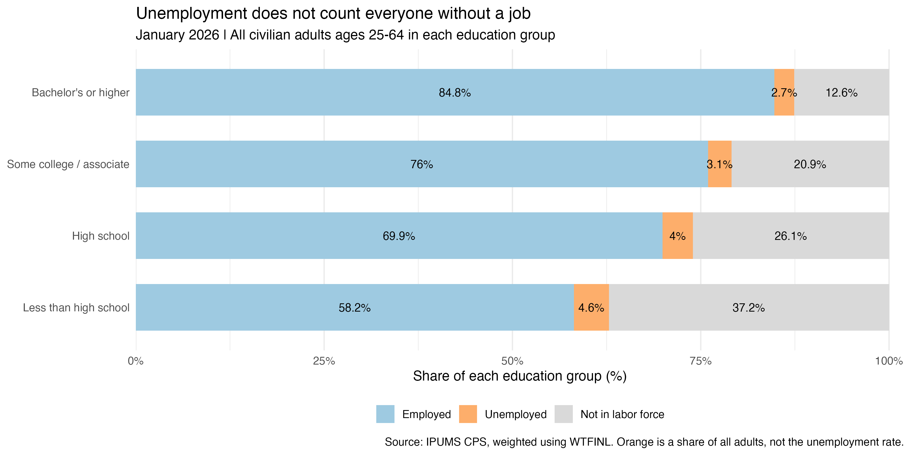

```{r}
#| include: false
source("analysis.R")
```

A degree takes years of work, and often a lot of money. One reason to keep going is the hope of having more job options afterward. But how closely is education related to unemployment? And does looking only at people in the labor force leave out part of the story?

I start with unemployment over time, then compare people of similar ages. Finally, I look beyond unemployment to include people outside the labor force. Each view answers a different question: is the gap persistent, does it remain within age groups, and who is missing from the unemployment rate?

The data come from [IPUMS CPS](https://cps.ipums.org/cps/), using Basic Monthly January samples for 2020–2026. I focus on civilians ages 25–64, since many younger people are still in school and some older people have retired. “Some college” includes associate degrees; “bachelor's or higher” includes graduate degrees.

I use the person weight [WTFINL](https://cps.ipums.org/cps-action/variables/WTFINL) because each survey respondent represents a different number of people. The unemployment rate is the weighted share of the labor force who are unemployed, including people looking for work or on temporary layoff. The final chart has a different denominator: all civilians ages 25–64 in each education group.



The gap is not just a feature of one month. The bachelor's-or-higher group has the lowest unemployment rate in every January shown. All four groups had higher rates in January 2021 than in January 2020, followed by declines in 2022 and 2023. In January 2026, the rate was `r round(latest$rate[1], 1)`% for people without a high school diploma and `r round(latest$rate[4], 1)`% for those with a bachelor's degree or higher.

Education seems related to how exposed people are to unemployment, even as the labor market changes. But these are January snapshots, not annual averages or seasonally adjusted rates. January 2020 was before the major pandemic changes, so the graph misses what happened later that year.

Could the gap simply reflect age? Education groups may contain different shares of younger and older workers, who also have different experience. The next chart compares education groups within the same ten-year age band.



The main pattern remains within all four age groups: people with a bachelor's degree or higher have lower unemployment than those with only high school or less. Among ages 25–34, the gap between the lowest and highest education groups is about `r round(age_rates$rate[age_rates$age_group == "25-34" & age_rates$education == "Less than high school"] - age_rates$rate[age_rates$age_group == "25-34" & age_rates$education == "Bachelor's or higher"], 1)` percentage points. It is smaller, but still present, in the older groups.

This matters for the original question. The overall education gap is not explained only by different age mixes across education groups. The ranking is not perfectly step-by-step: among ages 55–64, some college and bachelor's-or-higher rates are very close. Comparing age bands also does not hold jobs, experience, or family circumstances constant.

There is another limit to unemployment rates: people outside the labor force are not counted. The final chart brings them back in.



About `r round(status_shares$share[status_shares$education == "Less than high school" & status_shares$labor_status == "Employed"], 1)`% of adults without a high school diploma were employed, compared with `r round(status_shares$share[status_shares$education == "Bachelor's or higher" & status_shares$labor_status == "Employed"], 1)`% of those with a bachelor's degree or higher. The shares outside the labor force were `r round(status_shares$share[status_shares$education == "Less than high school" & status_shares$labor_status == "Not in labor force"], 1)`% and `r round(status_shares$share[status_shares$education == "Bachelor's or higher" & status_shares$labor_status == "Not in labor force"], 1)`%, respectively. The orange segments are shares of all adults, so they are not the unemployment rates in the first two charts.

The difference in employment is therefore broader than unemployment alone suggests. People outside the labor force may be studying, caring for family, retired, or unable to work. They should not all be treated as unsuccessful job seekers.

## Takeaway

The three views point to a consistent association: higher education goes with lower unemployment over time and within age groups, and with a larger share of adults employed. That makes education relevant to job opportunities, but it does not prove that a degree causes these differences. These are survey estimates, and I have not tested statistical significance. Small gaps deserve caution, especially in smaller age groups.

Data citation: Sarah Flood et al. (2025). *IPUMS CPS: Version 13.0* [dataset]. Minneapolis, MN: IPUMS. [doi:10.18128/D030.V13.0](https://doi.org/10.18128/D030.V13.0).
