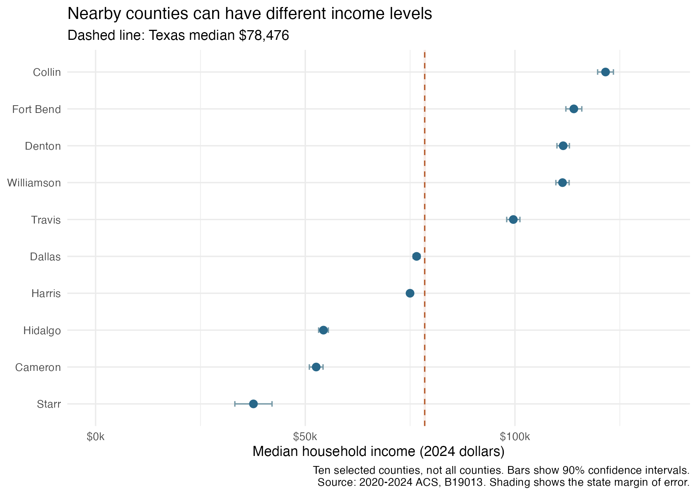

```{r}
#| include: false
counties <- read.csv("data/county-estimates.csv")
summary <- read.csv("data/summary.csv")
```

How much does a typical Texas household earn? A single number gives a quick answer, but Texas is a large state. It seems unlikely that the same number describes a household near Dallas and one near the southern border equally well. I wanted to see where higher and lower household incomes are located, and what we miss when we use the state as one unit.

This matters when deciding where to look more closely at local needs. A county below the state income level may deserve a different set of questions about jobs, housing, or services than a county far above it. A map cannot decide where funding should go, but it can show differences that a statewide number hides.

I use the Census Bureau's [2020–2024 ACS five-year estimates](https://www.census.gov/programs-surveys/acs/data/summary-file.2024.html), table B19013. The measure is median household income: the middle of the household income distribution, not an individual salary or the mean household income. Values are in 2024 dollars. These estimates combine five years of survey data, so they do not describe only households surveyed in 2024.

I used R to get income estimates from the Census API and read the [2024 county boundaries](https://www2.census.gov/geo/tiger/GENZ2024/shp/cb_2024_us_county_500k.zip). I selected Texas and matched the two datasets by county ID. I used tmap for the saved map and Leaflet for the interactive version below. All `r summary$counties` counties matched, with no missing income estimates. The map uses the same dollar scale across the state; darker counties have higher estimated medians.

Zoom in to explore an area and click a county to see its income estimate and margin of error. County size shows land area, not population.

<iframe src="graph/texas-income-interactive.html" title="Interactive map of Texas county median household income" width="100%" height="600" style="border: 0;" loading="lazy"></iframe>

[Open the interactive map in a new page](graph/texas-income-interactive.html) · [View the static map](graph/texas-income-map.png)

The darker areas are concentrated in several places rather than spread evenly across Texas. Collin and Denton, north of Dallas, both have median household incomes above $100,000. Another high-income area appears around Austin, including Travis and Williamson. Fort Bend, southwest of Houston, also stands out. These examples show where some higher-income counties are located. They do not compare all urban and rural counties or show that living near a city causes higher income.

Farther south, Starr, Hidalgo, and Cameron form a neighboring group with lower estimates. Starr's median is $`r format(counties$income[counties$NAME == "Starr"], big.mark = ",", scientific = FALSE, trim = TRUE)`, compared with the Texas median of $`r format(summary$state_income, big.mark = ",", scientific = FALSE, trim = TRUE)`. Hidalgo and Cameron are higher than Starr, but both remain below the state figure. This is more useful than identifying one low-income county: it points to a broader area where local conditions deserve attention. The data alone cannot tell us why these differences exist.

The large pale counties in western Texas need careful reading too. They occupy much of the map, but land area is not the number of people living there. Also, `r summary$below_state` of the `r summary$counties` county estimates are below the state median. That does not mean the same fraction of Texas households has below-median income. Counties have different numbers of households, and the statewide median is not the average of county medians.



The second figure makes nearby differences easier to see. Collin's median is $`r format(counties$income[counties$NAME == "Collin"], big.mark = ",", scientific = FALSE, trim = TRUE)`, while Dallas County's is $`r format(counties$income[counties$NAME == "Dallas"], big.mark = ",", scientific = FALSE, trim = TRUE)`. Fort Bend is also above Harris County, which contains much of Houston. A broad label such as “the Dallas area” or “the Houston area” would hide these contrasts. The ten counties are selected examples, not a random sample or a ranking of every county.

The bars extend one published margin of error on each side of the estimate, showing the Census Bureau's [90% confidence intervals](https://www.census.gov/programs-surveys/acs/methodology/sample-size-and-data-quality/sample-size-definitions.html). Estimates are not exact, so small color differences should not become firm rankings. Glasscock is a useful warning: its estimated median exceeds $100,000, but its margin of error is about $`r format(round(counties$moe[counties$NAME == "Glasscock"] / 1000) * 1000, big.mark = ",", scientific = FALSE, trim = TRUE)`. A dark county is not always a precisely measured high-income county.

Income also does not measure living standards by itself. These estimates do not adjust for local housing costs or household size, and county medians hide differences within counties. Explaining the pattern would require more information about residents and local economies.

## Takeaway

The map shows several high-income pockets near major cities and a lower-income group along part of the southern border. The selected counties also show that incomes can differ widely within the same urban area. I would use this map to choose where to investigate further, then check smaller areas, living costs, and uncertainty before making a decision. The state median is a starting point, not a description of every community.
