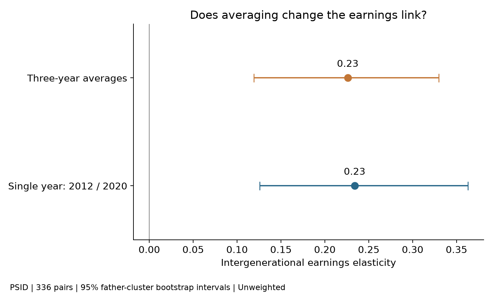
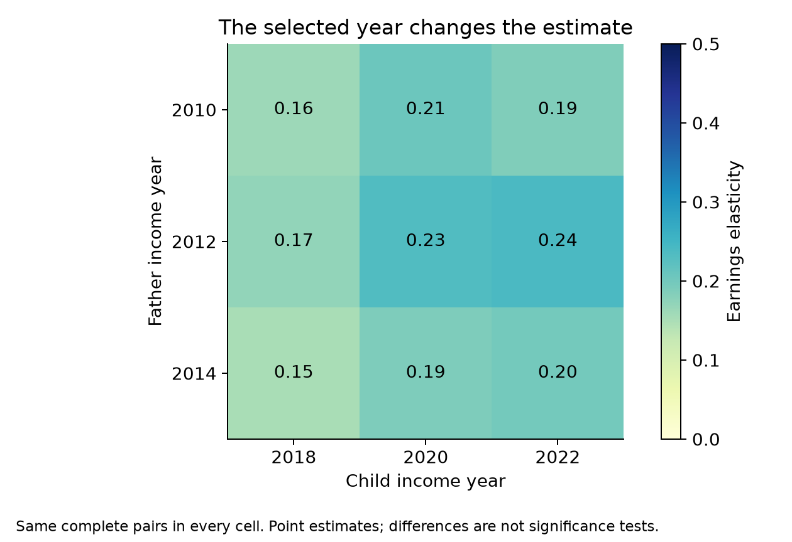
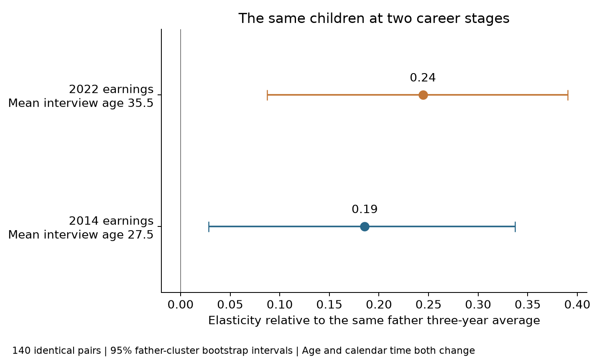

Imagine judging someone's career by the year they lost a job. Or by the year they received an unusually large bonus. Neither number is wrong, but neither tells the whole story.

As a student preparing to enter the job market, I wonder how much a first salary can tell us. In this tutorial, I match fathers and adult children using SQL in Python, then compare their earnings using one year and several years. I also check whether measuring children earlier in their careers changes the result.

## Step 1. Download the Data

I use the [Panel Study of Income Dynamics (PSID)](https://simba.isr.umich.edu/Zips/ZipMain.aspx), which follows people and families over time. After registering, download the 2023 Parent Identification File and the 1968–2023 Cross-Year Individual File. In the [Data Center](https://simba.isr.umich.edu/DC/i.aspx), select family labor-income variables for the 2011, 2013, 2015, 2017, 2019, 2021, and 2023 survey waves. These interviews report earnings from the previous year. Save the files in your project folder and follow PSID's data-use conditions. The [data README](https://github.com/emmazhu-collab/blog6/blob/main/data/raw/README.md) lists the exact variables; the downloaded 2017 wave is not used in this analysis.

These files tell us who belongs to whom, where each person lived in each survey year, and how much they earned. I focus on birth fathers because my earliest income extracts include only Head earnings. The income measure excludes farm and unincorporated business income.

## Step 2. Prepare the Data with Python

I use Python to organize the data. For each person, I need a permanent ID, an interview year, a family ID, age, family role, and earnings. I also need a table linking children to their fathers. The supplied `.do` files give the column positions Python needs to read the TXT files.

After preparing the tables, I load them into SQLite. Here is a short example using the father–child links:

```python
import sqlite3
import pandas as pd

con = sqlite3.connect(":memory:")
links.to_sql("parent_links", con, index=False)
linked_ids = pd.read_sql_query(
    "SELECT child, father FROM parent_links", con
)
```

Here, `links` is the father–child table prepared from PSID. `SELECT` chooses the columns to return. The full analysis loads the other tables too: SQL does the matching and averaging, and Python calculates the IGE. The full [Python and SQL code](https://github.com/emmazhu-collab/blog6) includes the preparation steps.

## Step 3. Match Fathers and Children with SQL

Now I need to connect each child's earnings to their father's earnings. Permanent person IDs identify the biological relationship. To find each person's income, I also match interview year and family interview number. A family number alone cannot track a person across years.

This short query shows the individual-to-family matching keys:

```sql
SELECT p.person, p.wave, p.family
FROM people AS p
JOIN family_income AS f
  ON p.wave = f.wave
 AND p.family = f.family;
```

I match both the interview year and family ID because the same family number may appear in different survey years. This query shows the connection only; assigning earnings also requires each person's family role.

The family role matters: Reference Person earnings belong only to the current Reference Person, and Spouse/Partner earnings only to that person. I do not give everyone in a household the same earnings.

Once Step 4 creates the income summaries, this query connects them:

```sql
SELECT l.child, l.father, f.father_mean, c.child_mean
FROM parent_links AS l
JOIN father_means AS f ON l.father = f.person
JOIN child_means AS c ON l.child = c.person
WHERE l.child <> l.father;
```

For a fictional teaching example, suppose father 101 belongs to child 205. The first `JOIN` adds father 101's average earnings of $50,000; the second adds child 205's $40,000. These are made-up values, not observations used in the analysis. Without the joins, the income records would not tell us which father belongs to which child.

I check the matches and keep pairs with enough income information for both people. These inner joins leave out pairs missing either summary.

## Step 4. Calculate Average Income

To compare years fairly, I first convert earnings to 2022 dollars using [BLS CPI from FRED](https://fred.stlouisfed.org/series/CPIAUCNS). Then I calculate each father's average:

```sql
SELECT person, AVG(real_income) AS father_mean
FROM earnings
WHERE year IN (2010, 2012, 2014)
  AND age BETWEEN 35 AND 60 AND real_income > 0
GROUP BY person
HAVING COUNT(DISTINCT year) = 3;
```

`WHERE` selects the years, ages, and positive earnings. `GROUP BY` collects each person's observations, and `AVG` averages them. `HAVING` requires three distinct years, so one available year cannot count as a three-year average.

I use child earnings in 2018/2020/2022 and ages 30–50. Ages refer to the interviews reporting the previous year's earnings. Requiring all six positive observations leaves 336 pairs and 238 fathers. Both comparisons use these same people.

## Step 5. Compare the IGE Estimates

IGE measures how strongly children's earnings are associated with their fathers' earnings:

$$
\log(Y_{\text{child}})=\alpha+\beta\log(Y_{\text{father}})+u
$$

The coefficient $\beta$ is the IGE. A larger value means a stronger earnings link and less relative mobility in this sample. This is an association, not a causal effect.

This Python function calculates the ordinary least-squares slope with an intercept. I average real earnings before taking logs:

```python
import numpy as np

def slope(x, y):
    x = np.log(np.asarray(x))
    y = np.log(np.asarray(y))
    return float(np.sum((x-x.mean()) * (y-y.mean()))
                 / np.sum((x-x.mean())**2))

single = slope(sample["f2012"], sample["c2020"])
averaged = slope(sample["father_mean"], sample["child_mean"])
```



The single-year IGE, using father 2012 and child 2020 earnings, is 0.234, while the three-year average IGE is 0.226. Roughly, a 10% difference in fathers' earnings is associated with a 2.3% difference in children's earnings. The difference between estimates is small (-0.008), and its 95% bootstrap confidence interval (-0.084 to 0.050) includes zero. So, in this sample, averaging income does not clearly change the estimated relationship between fathers' and children's earnings.

However, this does not mean averaging is unnecessary. Income in one year may be affected by temporary changes, such as unemployment or a bonus. Averaging several years can reduce some of this variation and provide a better measure of long-run earnings. The next figure shows why the choice of year can matter.



Choosing other years gives estimates from 0.150 to 0.240. Individual earnings changes and conditions in a particular year can affect the comparison. This shows why relying on a single year may give an incomplete picture of the earnings relationship. These differences are not all necessarily statistically significant.

## Step 6. Check Life-Cycle Bias

A young worker may earn little while training but earn much more later. Measuring children's earnings early in their careers could therefore give a different estimate of their earnings link with parents. Averaging several early-career years may still miss their long-run position.

I compare 140 main-sample children who also had positive 2014 earnings and were aged 22–29 at the 2015 interview. They meet the main age requirements at the later 2019/2021/2023 interviews. I keep the same father-income average in both comparisons.



The IGE is 0.186 when children's earnings are measured at a younger age and 0.244 when they are measured later. Mean interview age rises from 27.5 to 35.5. This suggests that measuring earnings early in a career may give a different picture of the relationship between fathers' and children's earnings.

However, the confidence interval for the difference (-0.111 to 0.232) includes zero, so the change is not statistically clear. Age and calendar time also change together in this comparison. The results illustrate possible life-cycle bias, but they do not prove that age caused the difference.

These unweighted results describe complete, positive-earner records, not all families. Missing follow-up, imputed income, and changing family roles also matter. We do not observe lifetime earnings.

Overall, the single-year and averaged IGE estimates are similar in this sample, but choosing different income years gives different estimates. The comparison across career stages also suggests that the age at which earnings are measured may matter, although the difference is not statistically clear. Averaging several years can reduce temporary income changes, but it cannot fully address life-cycle bias. I would not judge a family's mobility from one convenient year.
