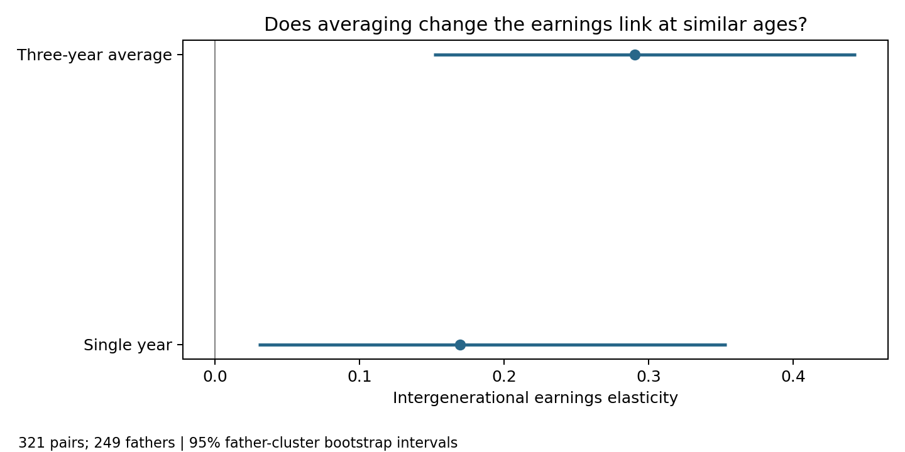

As I get ready to look for a job, I wonder what a first salary can tell me. One year may be unusual because of unemployment or a bonus. This matters for intergenerational mobility: how closely children's economic outcomes are connected to their parents'. If one unusual year stands in for usual earnings, we may misread that connection. Does using three years instead of one change the estimated link between fathers' and children's earnings?

## PSID data and the parent-child match

The [Panel Study of Income Dynamics (PSID)](https://psidonline.isr.umich.edu/) follows families and links generations. Its Parent Identification File links children to birth fathers. The Cross-Year Individual File gives ages, roles, and family links over time. Family earnings extracts from the [PSID Data Center](https://simba.isr.umich.edu/Zips/ZipMain.aspx) provide labor earnings. Earnings years run from 1993 to 2022, with gaps.

The IDs have different jobs. A person ID follows someone over time; a family ID identifies a household in one wave and may appear again later. I first match people to that wave's income record by family ID:

```python
p = p.merge(fam, on="family", how="left", validate="many_to_one")
```

This joins each person to the household record. Household role tells Python whether the earnings belong to the Head or spouse; I do not assign the Head's pay to everyone. SQL then uses person IDs to connect children to their fathers' earnings.

The codebooks define these labor-income measures without farm or unincorporated-business income, which PSID records separately. I exclude retrospective measures with different definitions and adjust earnings to 2022 dollars using CPI. PSID earnings generally refer to the previous calendar year, so 1993 earnings come from the 1994 interview. See the [1993](https://psidonline.isr.umich.edu/documents/psid/codebook/fam1993_codebook.pdf) and [1994](https://psidonline.isr.umich.edu/documents/psid/codebook/fam1994er_codebook.pdf) codebooks.

## Use SQL to connect and summarize earnings

Python keeps positive earnings observations at ages 35–45 and selects each person's three distinct years closest to age 40. The closest record gets rank 1. Years need not be consecutive because PSID does not interview everyone every year. Python loads the selected records and father-child links into SQLite:

```python
import sqlite3
import pandas as pd
from pathlib import Path

query = Path("blog/posts/post6/sql/same_age_sample.sql").read_text()
with sqlite3.connect(":memory:") as con:
    chosen.to_sql("selected_earnings", con, index=False)
    sample[["child", "father"]].to_sql("eligible_links", con, index=False)
    pairs = pd.read_sql_query(query, con)
```

This example runs from the website project's root directory. The `chosen` and `sample` tables are prepared earlier in Python, with the full code available in the repository.

Here is an excerpt from the [complete SQL query](sql/same_age_sample.sql). It shows how the earnings summaries are made and attached to each family link:

```sql
WITH summaries AS (
  SELECT person,
         AVG(real_income) AS mean_income,
         MAX(CASE WHEN rank = 1 THEN real_income END) AS single_income
  FROM selected_earnings
  WHERE age BETWEEN 35 AND 45 AND real_income > 0
  GROUP BY person
  HAVING COUNT(*) = 3 AND COUNT(DISTINCT year) = 3
)
SELECT l.child, l.father,
       f.mean_income AS father_mean_income,
       c.mean_income AS child_mean_income,
       f.single_income AS father_single_income,
       c.single_income AS child_single_income
FROM eligible_links AS l
JOIN summaries AS f ON l.father = f.person
JOIN summaries AS c ON l.child = c.person
WHERE l.child <> l.father;
```

`SELECT` picks IDs and earnings. `GROUP BY` gathers each person's records, and `AVG()` calculates the mean. `HAVING` requires three records from three distinct years. One `JOIN` adds the father's earnings; the next adds the child's. The full query also requires father and child ages to be within two years for both the single-year and average measures. The average age summarizes three interviews; it is not one exact age.

## Measure earnings near age 40

The single-year measure uses the record closest to age 40; the average uses all three. Both use the same 321 pairs and 249 fathers. Keeping the sample fixed means the comparison focuses on the income measure, not different families. Interview age is an approximation because earnings usually refer to the previous calendar year.

Requiring repeated positive earnings leaves out people with zero or missing earnings. The matched families may have more stable work, so they do not represent everyone in the PSID or U.S. population.

## Compare the IGE estimates

I estimate intergenerational earnings elasticity (IGE) with a log-log regression:

```python
import numpy as np

def estimate_ige(parent_col, child_col):
    x = np.log(pairs[parent_col].to_numpy())
    y = np.log(pairs[child_col].to_numpy())
    X = np.column_stack([np.ones(len(x)), x])
    return np.linalg.lstsq(X, y, rcond=None)[0][1]

single_ige = estimate_ige("father_single_income", "child_single_income")
average_ige = estimate_ige("father_mean_income", "child_mean_income")
```

The slope measures how closely children's earnings are associated with their fathers'. A higher IGE usually means less relative mobility. It is an association, not cause and effect.

$$
\log(Y_{child}) = \alpha + \beta\log(Y_{father}) + \varepsilon
$$



The single-year IGE is 0.170 (95% confidence interval: 0.030 to 0.354), while the three-year estimate is 0.291 (0.151 to 0.444). For example, with the three-year measure, a 1% difference in fathers' earnings is associated with about a 0.291% difference in children's earnings.

The higher three-year estimate suggests a stronger father-child earnings link and lower relative mobility. Both estimates use the same 321 father-child pairs, so the comparison reflects how earnings are measured rather than sample differences or a change in mobility over time.

One possible explanation is that temporary changes, such as unemployment or bonuses, make a single year's earnings less representative of someone's usual income. Averaging several years may reduce some of this noise. However, I cannot tell from this analysis whether temporary shocks explain the higher estimate.

The difference between the two IGEs is 0.121, with a 95% confidence interval from -0.037 to 0.268. Because the interval includes zero, I cannot confidently conclude that the two IGE estimates differ. This does not mean the two estimates are identical. Three years also cannot capture a whole career.

## Life-cycle bias: a useful but limited check

Life-cycle bias is different from a temporary income shock. It happens because earnings at one age may not reflect someone's long-term economic position. For example, someone studying or starting a job at 27 may earn much more later in life. Comparing fathers and children near age 40 helps make their career stages more similar, but people still follow different earnings paths. This is why matching ages cannot fully remove life-cycle bias.

For a separate group of 140 pairs, I hold fathers' three-year average fixed and compare children's earnings in 2014 and 2022. The IGE rises from 0.186 to 0.244 as the children's mean interview age rises from 27.5 to 35.5. The difference is uncertain (95% confidence interval: -0.111 to 0.232).


The comparison raises the possibility that measurement age matters. But the children are older in 2022 and economic conditions have also changed since 2014. I cannot separate these explanations, so the result does not prove that age caused the IGE to rise. These 140 pairs are also separate from the main sample.

## Takeaway

I began by wondering what my first salary would say about my future. In this sample, the father-child earnings link looks stronger with a three-year average than with one year, although the evidence for a difference is uncertain. Measuring both generations at similar ages and averaging several years can each help with a different problem, but neither captures a whole career. I learned that before using IGE to describe mobility, we need to ask whose earnings we measure and when.
