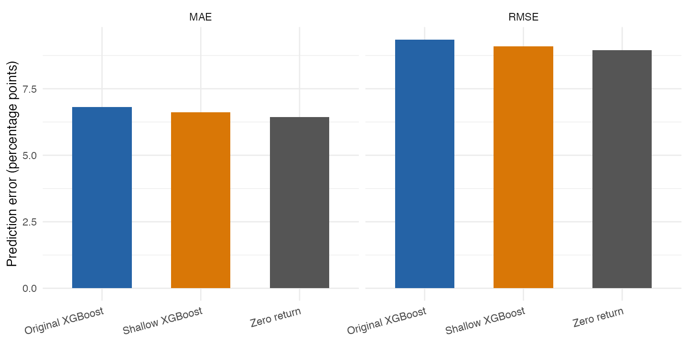
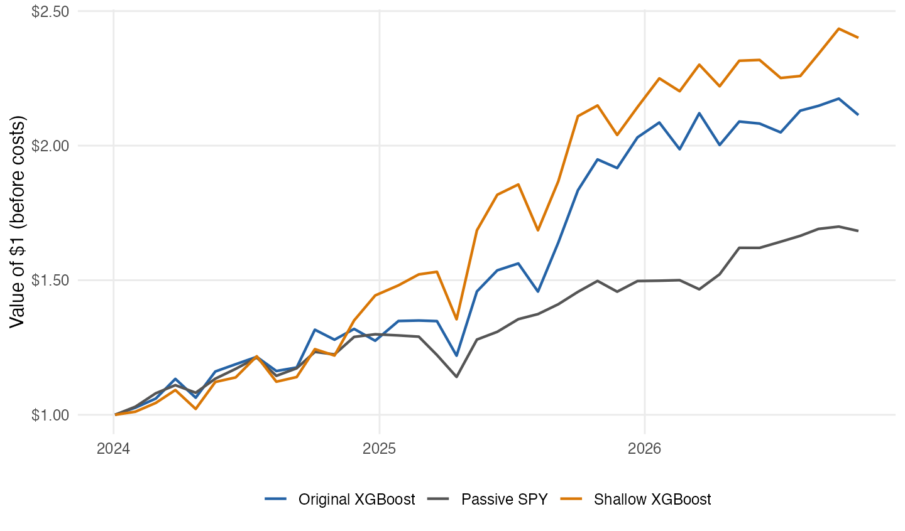

```{r}
#| include: false
post_dir <- if (file.exists("blog/posts/post9/results/tables/prediction_metrics.csv")) "blog/posts/post9" else "."
read_result <- function(name) read.csv(file.path(post_dir, "results", "tables", name))
metrics <- read_result("prediction_metrics.csv")
performance <- read_result("investment_metrics.csv")
window <- read_result("study_window.csv")
counts <- read_result("sample_counts.csv")
original <- performance[performance$model == "Original XGBoost", ]
shallow <- performance[performance$model == "Shallow XGBoost", ]
passive <- performance[performance$model == "Passive SPY", ]
pct <- function(x) sprintf("%.1f%%", 100*x)
pp <- function(x) sprintf("%.2f", 100*x)
num <- function(x) format(x, big.mark = ",", scientific = FALSE, trim = TRUE)
```

In class, we used XGBoost to rank stocks by predicted returns. Could a simpler model improve these forecasts, and would its predictions lead to better investment performance?

XGBoost adds decision trees one by one, each correcting earlier errors. It can capture patterns in prices, momentum, volatility, and market returns, but these may change when new information arrives. Our class model used 300 depth-five trees and trading volume, then selected the ten highest forecasts. It predicted the return from the next trading day's close to the close 19 trading-day intervals later. The classroom backtest suggested its portfolio could outperform the S&P 500 during the period tested, but that does not show it can keep doing so. Stock prices react to news, economic changes, and investor expectations, so past patterns may disappear. Results can also depend on the stocks, period, and backtest assumptions.

I tested a simpler model by reducing tree depth from five to two and increasing XGBoost's minimum child weight from ten to fifty. Both changes make it harder to fit detailed training patterns, though a simpler model might miss useful ones. I kept the predictors and other main settings the same.

For the test, I used the same 95-company list from class and daily prices from [Yahoo Finance](https://finance.yahoo.com/), downloaded with [tidyquant](https://business-science.github.io/tidyquant/reference/tq_get.html). The models used signals from 2022–2023 for training and signals from 2024 through October 2026 for testing. I removed training observations whose future-return periods crossed into the test period. For the portfolio comparison, both XGBoost models used adjacent, non-overlapping 19-interval holdings, and SPY used the same entry and exit dates. The 111.4% original-model return below is from this updated backtest, not the classroom result. I also compared both models' prediction accuracy with a zero-return forecast on the same test observations.

I measured prediction errors with RMSE and MAE. Lower values mean closer forecasts; RMSE penalizes large misses more, while MAE gives the average absolute miss. Results are in percentage points.

```{r}
tab <- data.frame(Model = metrics$model, `RMSE (percentage points)` = pp(metrics$rmse),
                  `MAE (percentage points)` = pp(metrics$mae), check.names = FALSE)
knitr::kable(tab, align = c("l", "r", "r"))
```

{fig-alt="The zero-return forecast has the lowest RMSE and MAE. Shallow XGBoost performs better than the original model."}

Shallow XGBoost improved on the original model, with RMSE falling from 9.35 to 9.10 and MAE from 6.82 to 6.62. However, the zero-return forecast still performed better on both measures (RMSE 8.95; MAE 6.44). One possible reason is that stock returns are noisy, so predicting zero can avoid some large forecasting errors. This does not mean zero is always the best prediction, and I did not test this explanation directly. RMSE and MAE do not measure ranking accuracy. Since the investment strategy selects only ten stocks, I also compared the resulting portfolios.

For the investment test, I ranked stocks at each signal day's close, bought the top ten at the next close, and sold them 19 trading-day intervals later as the next portfolio entered. I compared these portfolios with SPY, which tracks the S&P 500, using the same dates.

```{r}
order_rows <- match(c("Original XGBoost", "Shallow XGBoost", "Passive SPY"), performance$model)
z <- performance[order_rows, ]
knitr::kable(data.frame(Model = z$model, `Return before costs` = pct(z$cumulative_return),
  `Return after assumed costs` = pct(z$cost_adjusted_return),
  `Annualized Sharpe` = sprintf("%.2f", z$annualized_sharpe), check.names = FALSE),
  align = c("l", "r", "r", "r"))
```

{fig-alt="The shallow XGBoost portfolio ends highest, followed by the original XGBoost portfolio and SPY. This is a historical simulation, not a forecast."}

The portfolio results tell a different story from the forecast errors. Before costs, the shallow portfolio returned 140.1%, compared with 111.4% for the original and 68.3% for SPY. A few successful picks may explain much of the shallow model's gain: TSLA, Intel, Nvidia, and Micron were among its main contributors, and one stock could receive about a third of its weight. SPY had the highest annualized Sharpe ratio (1.51 versus 1.41 for shallow and 1.33 for original), indicating better risk-adjusted performance in this backtest. The calculation assumes a zero risk-free rate.

After the assumed 0.1% cost per purchase and sale, the shallow portfolio earned 122.9%, compared with 68.0% for SPY. This is an economically meaningful simulated gain in this historical test. However, concentrated holdings, a lower Sharpe ratio, and possible survivorship bias make it hard to know if the advantage would continue. These results are not enough to justify using the strategy for real investments.

The test still has limits. The 95-stock list was not rebuilt using only companies an investor could have selected at each historical date, which may make the backtest look stronger. It also covers one market period, and stocks share common shocks. The small difference in prediction errors may not hold in another sample.

## Takeaway

The classroom experiment showed that XGBoost could outperform the market in a historical backtest, but that alone did not prove reliable predictions. My simpler model slightly improved prediction accuracy compared with the original, although the zero-return forecast still performed better. The simpler model also earned the highest cumulative return in the backtest, but SPY had a higher Sharpe ratio and the portfolio was concentrated in a few stocks. I learned that a profitable backtest does not necessarily mean a model can accurately predict stock returns or provide a reliable investment strategy.
